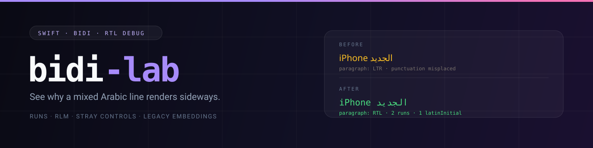

<p align="center">
  
</p>

<p>
  <a href="https://github.com/hfip/bidi-lab/actions/workflows/ci.yml"></a>
</p>

# bidi-lab

Two lines that look almost identical in an editor:

```swift
label.text = "iPhone الجديد"
label.text = "\u{200F}iPhone الجديد"
```

The first one renders with the paragraph direction taken from `iPhone`, so the Arabic looks
attached to the wrong side and punctuation drifts. The second one forces right-to-left with
a single invisible character. When this happens in production, the question is always the
same: which part of the string did it?

This package answers that for one line at a time.

```swift
BidiLab.explanation(for: "iPhone الجديد")
// ["2 run(s) — ltr: 7, rtl: 4",
//  "ltr [0..<7]: iPhone ",
//  "rtl [7..<11]: جديد",
//  "line starts with Latin text but contains Arabic; the paragraph direction
//   becomes LTR and punctuation moves — prefix an RLM"]
```

## What it gives you

- `direction(of:)` for a single character: `.rtl`, `.ltr`, `.number`, `.neutral`.
- `runs(in:)` splitting a line into maximal runs, with **character** offsets, so the indices
  match `Array(string)` and not UTF-8 or UTF-16.
- `issues(in:)` for three things that go wrong in practice:
  - `strayControl` — a bidi mark that ended up mid-line and survived copy/paste
  - `legacyEmbedding` — `RLE`/`PDF`/`RLO` leftovers from old translation tools
  - `latinInitial` — a line with Arabic that starts with a Latin word
- `addingRTLMarks(to:)` for the fix: prefixes an RLM to the lines that need one, keeps
  indentation, and does not add a second mark to a line that already has one.
- `removingControlCharacters(from:)` for the other direction.
- `explanation(for:)` producing the report above.

A leading RLM at the start of a line (after indentation) is treated as intentional. That
matters: the output of `addingRTLMarks(to:)` must not report its own fix as a problem, and
there is a regression test for exactly that.

## Install

```swift
.package(url: "https://github.com/hfip/bidi-lab.git", from: "0.1.1")
```

iOS 13+ / macOS 10.15+ / tvOS 13+ / watchOS 6+. No dependencies, 28 tests.

## SwiftUI playground

```swift
import SwiftUI
import BidiLab

struct DebugView: View {
    var body: some View { BidiLabView(initialText: "iPhone الجديد") }
}
```

The view shows the raw render, the run list with colours, the issues, and a button that
applies `addingRTLMarks(to:)`. It is wrapped in `#if canImport(SwiftUI)`, so the package
still builds in Linux CI and in server-side targets; only the analysis is exercised there.

## What this is not

It is not an implementation of the Unicode Bidirectional Algorithm. No resolved levels
(UBA rules W1–N2), no reordering, no rendering. It classifies characters, groups them into
practical runs, and names the mistakes that show up in real apps. For the real rules, read
[UAX #9](https://www.unicode.org/reports/tr9/).

If you want the opposite side of this problem, [rtl-lint](https://github.com/hfip/rtl-lint)
checks constraints and alignments in your Swift sources before any of this reaches a screen.

## بالعربي

<div dir="rtl" align="right">

`iPhone الجديد` و`‏iPhone الجديد` يطلعون مختلفين على الشاشة، والفرق حرف واحد غير مرئي
(`U+200F`). المشكلة إنك ما تشوفه في المحرر، فما تعرف وين الخلل.

الحزمة تعطيك:

- تصنيف كل حرف: عربي (RTL)، لاتيني (LTR)، رقم، أو محايد.
- تقسيم السطر إلى مقاطع مع مواقعها.
- كشف الحروف الخفية والـ embeddings القديمة، والحالة الشهيرة: سطر يبدأ بكلمة لاتينية
  وفيه عربي.
- الإصلاح: `addingRTLMarks(to:)` يضيف RLM في بداية السطر المناسب.

وفيها واجهة SwiftUI للفحص البصري بسرعة.

</div>

Part of the [Arabic dev tools](https://github.com/hfip/arabic-dev-tools) collection.

## License

MIT. See [LICENSE](LICENSE).
